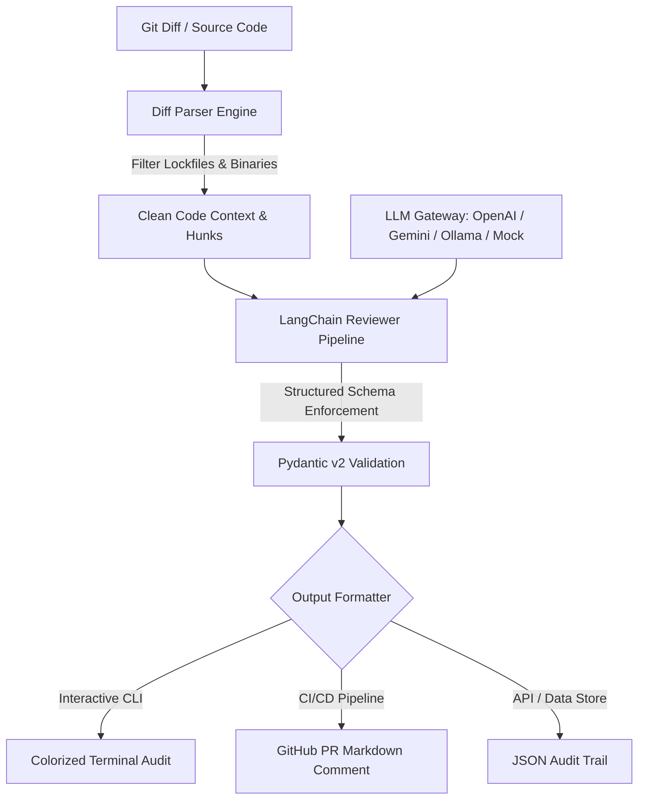

# 🚀 AI PR Debugger & Automated Code Reviewer

[](https://www.python.org/downloads/)
[](https://python.langchain.com/)
[](https://docs.pydantic.dev/)
[](https://pytest.org)
[](LICENSE)

An intelligent, production-grade Pull Request code reviewer and automated debugger. Built with **LangChain**, **Pydantic v2**, and **OpenAI/Gemini/Ollama-compatible LLM orchestration**, it analyzes git diffs and source code to identify bugs, security vulnerabilities, edge cases, and performance regressions with actionable fixes and unit test generation.

---

## 📑 Table of Contents
- [Key Features](#-key-features)
- [Architecture & Flow](#-architecture--flow)
- [Terminal Output Preview](#-terminal-output-preview)
- [Quick Start](#-quick-start)
  - [1. Clone and Setup](#1-clone-and-setup)
  - [2. Environment Configuration](#2-environment-configuration)
  - [3. Running Reviews](#3-running-reviews)
- [CLI Reference](#-cli-reference)
- [Supported Providers](#-supported-providers)
- [GitHub Actions CI/CD Integration](#-github-actions-cicd-integration)
- [Running Tests](#-running-tests)
- [Resume / Portfolio Highlights](#-resume--portfolio-highlights)

---

## 🌟 Key Features

- **⚡ Git Diff & Patch Parsing:** Intelligently parses unified git diffs (`git diff`, PR branch comparisons, patch files) and maps issues to specific files and line numbers while automatically filtering noisy lockfiles (`package-lock.json`, `poetry.lock`, etc.).
- **🛡️ Strict Safety Guardrails:** System prompts treat source code as untrusted input with prompt injection defense, preventing adversarial code comments from hijacking the review.
- **🎯 Strongly Typed Structured Outputs:** Powered by Pydantic v2 schemas enforcing taxonomy classification (Severity: `CRITICAL`, `HIGH`, `MEDIUM`, `LOW`; Category: `BUG`, `SECURITY`, `PERFORMANCE`, `LOGIC`, `RELIABILITY`).
- **🧪 Automated Regression Test Generation:** Every reported finding produces a copy-pasteable unit test snippet to verify the bug and prevent regressions.
- **🌐 Universal LLM Gateway Support:** Seamlessly connect to OpenAI (`gpt-4o-mini`), Google Gemini, local offline Ollama models (`llama3.2`, `deepseek-coder`), or enterprise gateways (LiteLLM, MLflow).
- **🖥️ Beautiful Multi-Format Output:** Renders formatted terminal reports with cross-platform colors, exports machine-readable JSON, or generates GitHub-flavored markdown ready for PR comments.
- **🔄 Zero-Dependency Mock Mode:** Built-in offline mock mode (`--mock`) allows CI pipelines and local developers to test the full pipeline without API keys or costs.

---

## 🏗️ Architecture & Flow



---

## 🖥️ Terminal Output Preview

```text
======================================================================
  AI PR DEBUGGER - AUTOMATED CODE AUDIT REPORT
======================================================================
 Verdict: [REQUEST_CHANGES]
 Summary: Completed automated audit. Identified 1 potential issue(s) requiring attention.
 Findings: Total: 1 | Critical: 0 | High: 1
----------------------------------------------------------------------

#1 [HIGH] [BUG] Addition arithmetic operator used instead of multiplication for total calculation. in examples/buggy_code.py:L2
  Impact: Incorrect financial totals calculated, undercharging or overcharging customers.
  Recommended Fix:
    return price * quantity
  Regression Test:
    def test_calculate_total():
        assert calculate_total(100, 3) == 300

======================================================================
```

---

## 🚀 Quick Start

### 1. Clone and Setup

Using standard `venv`:
```bash
git clone https://github.com/your-username/ai-pr-debugger.git
cd ai-pr-debugger

python -m venv .venv
# On Windows:
.venv\Scripts\activate
# On Linux / macOS:
source .venv/bin/activate

pip install -r requirements.txt
```

*(Alternatively, using [uv](https://github.com/astral-sh/uv) for ultra-fast setup: `uv venv && uv pip install -r requirements.txt`)*

### 2. Environment Configuration

Copy the example environment file:
```bash
cp .env.example .env
```

Open `.env` and configure your preferred provider. (See [.env.example](.env.example) for options).

### 3. Running Reviews

**Review a specific file:**
```bash
python -m app review examples/buggy_code.py
```

**Review current unstaged git changes:**
```bash
python -m app review --git
```

**Review against a target branch (e.g. `main`):**
```bash
python -m app review --git --branch main
```

**Run offline in mock mode (no API key required):**
```bash
python -m app review examples/buggy_code.py --mock
```

**Export as GitHub PR Markdown:**
```bash
python -m app review examples/buggy_code.py --mock --format markdown --output review.md
```

---

## 🛠️ CLI Reference

```text
usage: python -m app review [-h] [--git] [--staged] [--branch BRANCH]
                            [--format {terminal,markdown,json}]
                            [--min-severity {CRITICAL,HIGH,MEDIUM,LOW,INFO}]
                            [--mock] [--model MODEL] [--output OUTPUT]
                            [target]

positional arguments:
  target                Path to target source file or diff

optional arguments:
  --git                 Review uncommitted git modifications
  --staged              Review staged git changes
  --branch BRANCH       Branch to compare against
  --format FORMAT       Output format: terminal (default), markdown, json
  --min-severity SEV    Filter findings by minimum severity threshold
  --mock                Execute in deterministic offline mock mode
  --model MODEL         Specify model override (e.g. gpt-4o, llama3.2)
  --output OUTPUT       File path to write report output
```

To test provider connectivity:
```bash
python -m app test-gateway
```

---

## 🌐 Supported Providers

| Provider | Environment Variables | Sample Model | Cost |
| :--- | :--- | :--- | :--- |
| **OpenAI** | `OPENAI_API_KEY` | `gpt-4o-mini` | Paid / Tiered |
| **Ollama (Local)** | `LLM_BASE_URL=http://localhost:11434/v1` | `llama3.2`, `deepseek-coder` | **100% Free** |
| **Google Gemini** | `LLM_BASE_URL=https://generativelanguage.googleapis.com/v1beta/openai/`, `LLM_API_KEY` | `gemini-1.5-flash` | Free tier / Paid |
| **Mock Engine** | `--mock` flag or `MOCK_LLM=true` | Built-in Mock | **Free / Offline** |

---

## 🤖 GitHub Actions CI/CD Integration

The repository includes a production-ready workflow in [`.github/workflows/ai-review.yml`](.github/workflows/ai-review.yml). 

When a Pull Request is opened:
1. It automatically fetches the git diff between the PR branch and base branch.
2. Runs the AI PR Debugger review engine.
3. Posts structured markdown comments with severity badges directly to the PR discussion.

---

## 🧪 Running Tests

Run the test suite using pytest:
```bash
pytest -v
```

All unit tests and diff parsing tests execute in isolation with mock fixtures, ensuring clean and deterministic execution in any CI environment.

---

## 💼 Resume / Portfolio Highlights

*Ready-to-use bullet points tailored for your resume:*

- **AI Code Review & Debugging Engine:** Architected and implemented an automated PR code audit tool using **Python**, **LangChain**, and **Pydantic v2**, extracting unified git diffs and detecting edge cases, security vulnerabilities, and logic bugs before production deployment.
- **Structured LLM Orchestration:** Designed strict structured output schemas with Pydantic v2 and system prompt injection defenses, generating automated remediation code snippets and regression unit test cases with near-zero hallucinations.
- **Multi-Model & Edge Deployment:** Integrated universal LLM gateway compatibility supporting **OpenAI**, **Google Gemini**, and local offline inference via **Ollama (Llama 3 / DeepSeek-Coder)**, enabling zero-cloud-cost developer workflows.
- **CI/CD Automation:** Engineered an automated **GitHub Actions** workflow that triggers on pull requests, parses hunk changes, and publishes formatted markdown code audits directly to pull request discussions.

